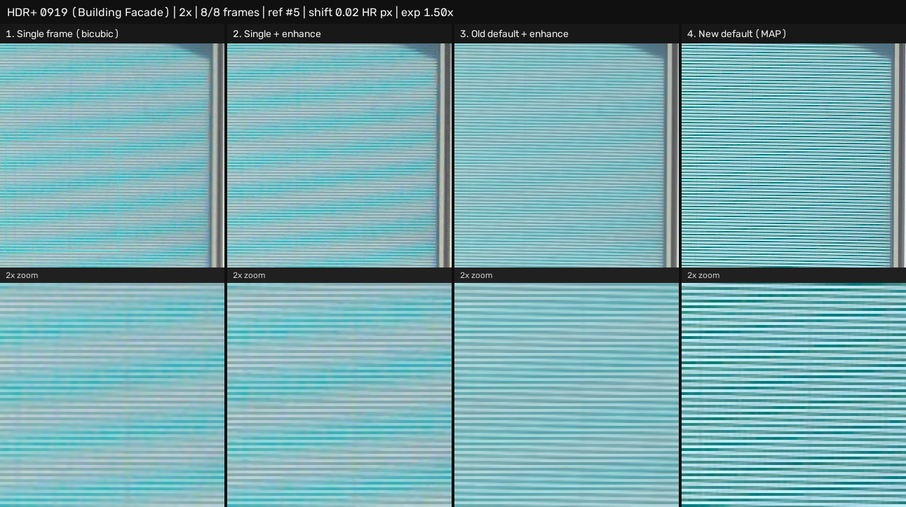
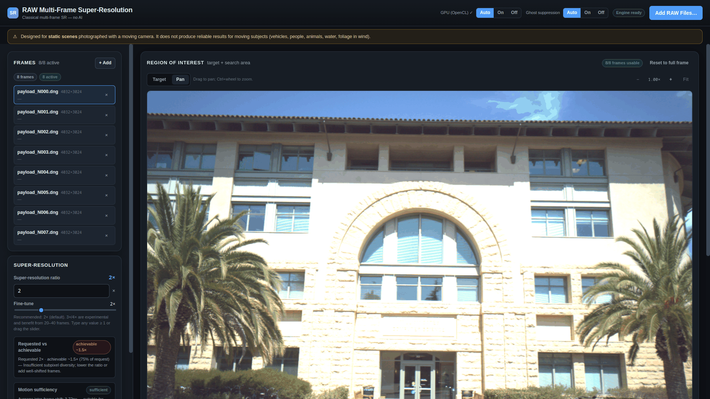
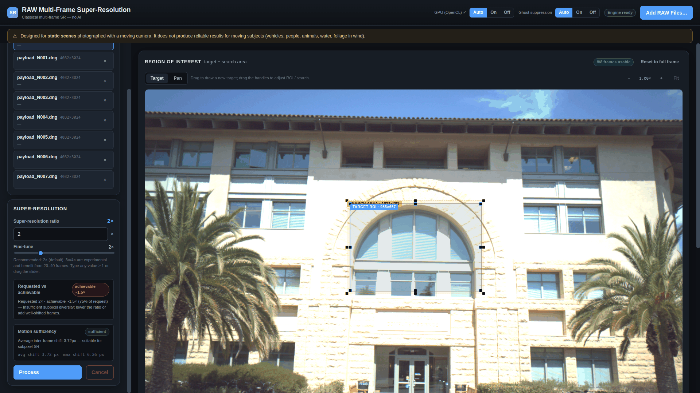
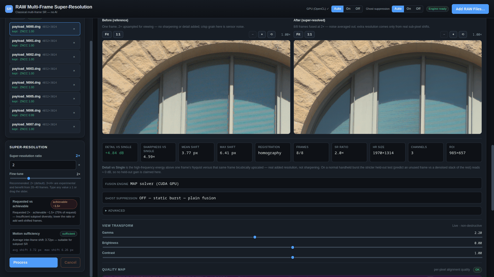
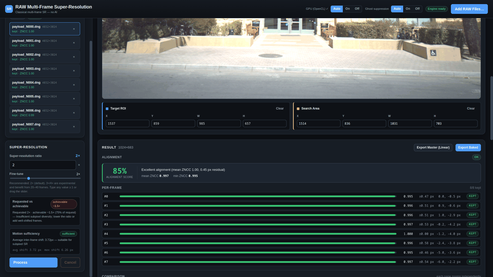
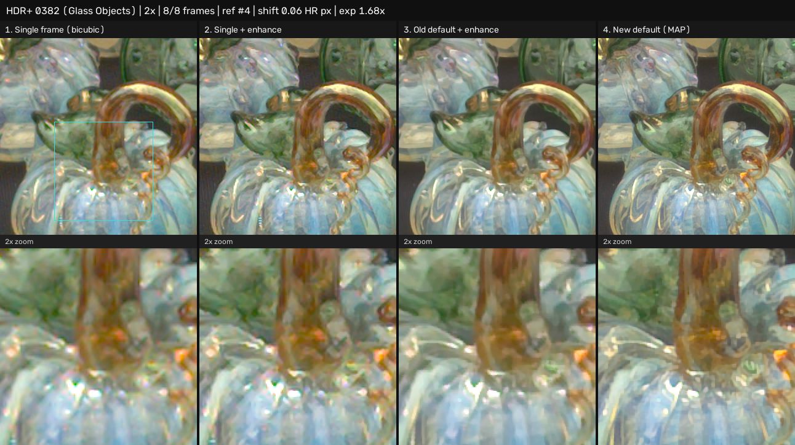
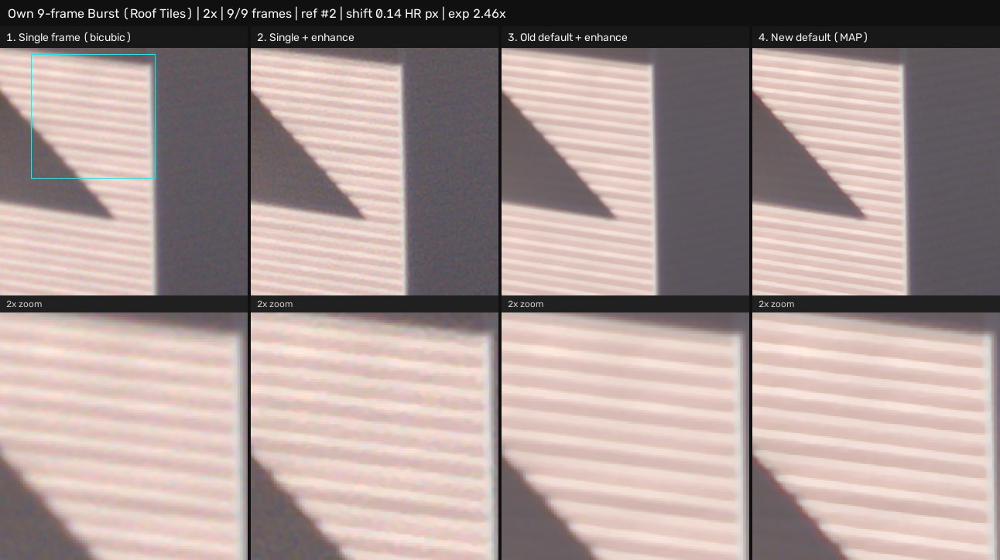
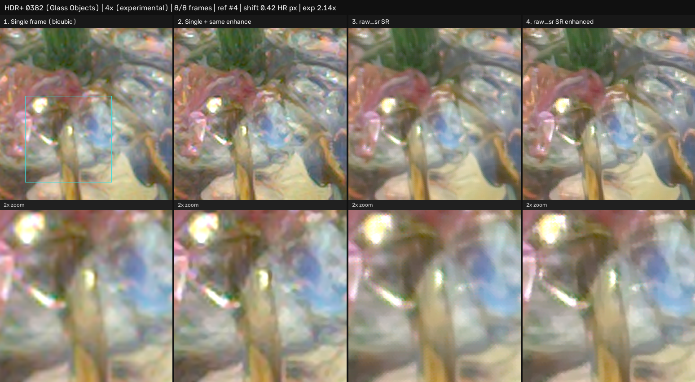

<h1 align="center">raw-sr</h1>
<p align="center"><b>Multi-frame RAW super-resolution from real measurements — not from guesses.</b><br>
Classical signal processing for handheld RAW bursts: sub-pixel registration, a forward-model MAP solver and honest, pixel-aligned evaluation.</p>
<p align="center">
<a href="LICENSE"></a>


</p>
<p align="center"><b>English</b> · <a href="README.tr.md">Türkçe</a></p>

**Classical multi-frame RAW super-resolution — no neural networks.** It fuses a handheld RAW burst and recovers resolution and noise reduction from real sub-pixel information between frames, not from artificially sharpening a single frame.



*`HDR+ 0919_20150910_131720_137` (building facade), **2×** scale, 8/8 frames, reference frame `#5`. All four panels share the exact same HR lattice (single-frame–MAP offset over the full frame `0.02 HR px`, old–new default `0.01 HR px`) and the same linear exposure + `gamma = 2.2`. Left to right: **(1)** single reference frame (bicubic), **(2)** single frame + classical enhancement (fairness baseline), **(3)** previous default (`demosaic_drizzle`) + classical enhancement, **(4)** new 2× default: forward-model MAP SR that also inverts the lens blur measured from the burst (`fusion="auto"`, `map_mode="wp13"`, no extra sharpening; `docs/WP13_MAP_REAL.md`, `docs/WP15_MAP_DEFAULT.md`). Bottom row: 2× nearest-neighbour zoom of the highest-texture region. The louvre lines in (4) are clearly sharper and higher in contrast; the regular pixel texture of the earlier MAP version is gone. **Honest note:** in the zoom some dark lines look slightly darker than their neighbours (a mild beat pattern). Source data: HDR+ Burst Photography Dataset (Hasinoff et al., 2016), CC-BY-SA; this image is derived from that dataset and shared under the same license.*


## Why this project exists

Most "AI upscalers" make an image look sharper by **predicting** detail a neural network has learned from other photos. The result can look convincing, but the added detail is a guess: it may not exist in the scene you photographed.

raw-sr takes the opposite approach. A handheld burst of RAW frames contains real, slightly shifted samples of the same scene; raw-sr registers them with sub-pixel accuracy and **solves** for the higher-resolution image that best explains those measured samples (Bayer sampling, lens blur and noise are modelled explicitly). Every pixel of the output is constrained by data that was actually recorded. Nothing is hallucinated, and the project keeps its claims honest: each result is shown pixel-aligned against a single frame and the previous method, with the measurements and the caveats next to it.

**On AI assistance.** This project is not "anti-AI". The software itself contains no neural networks or trained models, because its goal is clarity that comes from measurement rather than predictive reconstruction. The *development*, however, was done with substantial help from AI coding assistants (research surveys, implementation, tests, evaluation scripts and documentation), under human direction and review. All numbers in this README come from scripts in this repository and can be reproduced.

## What it does

- Registers a handheld RAW burst (DNG, CR2, NEF, ARW and other LibRaw formats) with sub-pixel accuracy (phase correlation + ECC homography).
- At 2× it uses a forward-model MAP super-resolution that jointly inverts Bayer sampling, optics blur and the colour matrix; drizzle fusion without a GPU or at 3×/4×.
- Optional classical (non-neural) RL-TV deconvolution + starlet wavelet sharpening.
- Shows per-frame agreement (ZNCC), alignment quality and motion-sufficiency warnings; rejects mismatched frames automatically.
- Exports a 16-bit linear master TIFF and a display-transformed TIFF.
- Electron + React desktop UI over a local FastAPI backend; everything runs on your own machine.

## How it works

A desktop application that recovers **real spatial resolution** and reduces noise from a handheld burst of RAW photographs — not by hallucinating detail or over-smoothing a single frame.

It is purely classical computer vision and signal processing (OpenCV + NumPy + rawpy/LibRaw): phase-correlation + ECC sub-pixel homography registration, at 2× a forward-model MAP super-resolution that jointly inverts Bayer sampling, optics blur and the colour matrix (drizzle fusion without a CUDA GPU or at 3×/4×), and optional classical (non-neural) RL-TV deconvolution + starlet wavelet sharpening. No neural networks, no trained models.

## Quick start

Requirements: Python 3.11+, Node.js 20+ and `npm` (details below, “Install and run”).

```bash
git clone https://github.com/turkerinal/raw-sr.git raw-sr
cd raw-sr
./run.sh
```

`run.sh` installs the Python dependencies and UI packages inside this repository; nothing is installed globally.

**Linux AppImage (no installation):** download `raw-sr-<version>-x86_64.AppImage` from the Releases page, make it executable (`chmod +x`, or *Properties → Allow executing*) and double-click it. It bundles its own Python and libraries (~280 MB) and runs the classical CPU path everywhere. With an NVIDIA GPU, run once from a terminal `./raw-sr-<version>-x86_64.AppImage --install-gpu`: it downloads CuPy for your driver (~2 GB, into `~/.local/share/raw-sr/gpu-site`) and 2× runs then use the MAP solver. To build the AppImage yourself: `scripts/build_appimage.sh`.

**NVIDIA GPU (recommended for 2×):** the 2× default MAP solver needs [CuPy](https://cupy.dev), which is not installed automatically because the right package depends on your CUDA version. Install it into the project's environment, e.g. `venv/bin/pip install "cupy-cuda13x[ctk]"` (CUDA 13) or `venv/bin/pip install "cupy-cuda12x[ctk]"` (CUDA 12). Without CuPy or without an NVIDIA GPU everything still works, but `fusion="auto"` uses the classical `demosaic_drizzle` path instead of MAP.

## Desktop app

The images below are real screenshots of the app (full screen, 1920×1080) taken from the Electron window with `scripts/gui_screenshots.cjs`. Data: HDR+ `0919` burst (8 frames). In this run the 2× default forward-model MAP solver ran on a CUDA GPU (see the “Fusion engine: MAP solver (CUDA GPU)” line in the result panel).



**1. Burst loaded.** Left to right: frame list, super-resolution ratio (default 2×), warnings (“achievable ~1.5×”: an 8-frame burst does not fully support a 2× request) and the region (ROI) preview.



**2. Settings and ROI.** Target ROI (`985×657`) and search area drawn by dragging on the preview; ratio, motion sufficiency (“sufficient”) and the **Process** button.



**3. Result.** The reference frame (2× resampled) next to the super-resolved result, each pane zoomable independently; metrics below (frames, shift, ROI, HR size).



**4. Alignment and export.** Alignment score, per-frame ZNCC / residual shift / “kept” status, and the **Export Master (Linear)** / **Export Baked** buttons.

*Photograph in the screenshots: HDR+ Burst Photography Dataset (Hasinoff et al., 2016), `0919_20150910_131720_137`, **CC-BY-SA**; these images are shared under the same licence.*

### Workflow

1. **Select RAW Files…** — pick a handheld burst of the same static scene (5–9 frames work; **20–40 frames** recommended for best results). DNG, CR2, NEF, ARW, and other LibRaw formats.
2. **SR Ratio** — **Default 2×** (recommended). **3× and 4× are experimental.**
3. **ROI (x, y, w, h)** — region to process (capped at `2048 × 2048` input pixels for memory safety).
4. **Process** — loading, registration, and fusion run in the Python backend and are cancellable.
5. **Export** — 16-bit linear master TIFF (`Export Master`), display-transformed 16-bit TIFF (`Export Baked`), or classical enhanced output (`enhanced` / `enhanced_baked`).

## More comparisons

| Scene (2×) | Comparison |
|---|---|
| HDR+ `0382` (glass objects, indoor, CC-BY-SA) |  |
| Own 9-frame DNG burst (roof tiles) |  |

### 4× Example (Experimental)



*`HDR+ 0382_20150912_130914_161`, **4× (experimental)** scale. Because short 8–9 frame bursts fill only 5–7 of the 16 sub-pixel bins on a 4× grid, 3× and 4× are marked experimental. Source data: HDR+ Burst Photography Dataset (Hasinoff et al., 2016), CC-BY-SA.*

## How much resolution do I really gain?

The honest answer: **focus on 2×.** Physically, how much real resolution a handheld burst can recover depends on the **number of frames** and **sub-pixel diversity**:

- **Short 8–9 frame bursts** fill 3–4 of the 4 sub-pixel bins at 2×, but only **5–7 of the 16 bins** at 4× (`docs/AUDIT_C11.md`). Therefore **2× is the default and recommended ratio**; **3× and 4× are experimental** and benefit from **20–40 frame bursts**.
- **At 2× the default MAP inverts the optics blur inside its forward model;** extra sharpening is neither needed nor recommended (synthetic GT drops `37.2 → 30.2 dB`). On the previous path (`demosaic_drizzle`: 3×/4× and machines without a CUDA GPU) the visible sharpness comes from **classical enhancement** on top of the clean SR master.

<details>
<summary><b>Measurement tables and synthetic ground-truth results</b></summary>

### Measured on Real Bursts (2×, Pixel-Aligned)

Real-edge MTF50 (cycles / LR pixel) and flat-area standard deviation (`flat_std`) measured by `scripts/make_showcase.py`:

| Burst (2×) | 1: Single frame (bicubic) | 2: Single + enhance | 3: Old default + enhance | 4: New default (MAP) |
|---|---|---|---|---|
| **HDR+ `0919`** (8/8 frames) | MTF50 `0.367` · σ `0.00356` | MTF50 `0.682` · σ `0.00426` | MTF50 `0.882` · σ `0.00157` | MTF50 `0.383` · σ `0.00181` |
| **HDR+ `0382`** (8/8 frames) | MTF50 `0.143` · σ `0.00216` | MTF50 `0.179` · σ `0.00243` | MTF50 `0.112` · σ `0.00105` | MTF50 `0.120` · σ `0.00129` |
| **Own 9-frame** (roof tiles) | MTF50 `0.051` · σ `0.00263` | MTF50 `0.142` · σ `0.00314` | MTF50 `0.126` · σ `0.00132` | MTF50 `0.052` · σ `0.00131` |

*Note: this automatic edge MTF50 disagrees with the images for the new MAP: on `own9` and `0919`, (4) is visibly the sharpest panel yet scores a low MTF50. The measurement counts sharpening overshoot and aliasing (values above 0.5) as sharpness, so it is given here only as a rough indicator. The new MAP's flat-area noise is on par with the old path + enhancement (`own9`: `0.00131` vs `0.00132`). The reliable measure of the sharpness gain is known ground truth: on the synthetic scene, versus the old default + enhancement, **+1.0 / +1.4 / +1.9 dB** at lens blur σ `0.35 / 0.60 / 0.90` LR px, MTF50 `0.60 → 0.83`, `0.44 → 0.75`, `0.31 → 0.58` (`docs/WP15_MAP_DEFAULT.md`).*

**How to read these numbers (honest interpretation):** MTF50 alone does not show the gain. The high MTF50 values on the single frame and single + enhance (e.g. `0.682` for `0919`, above the LR Nyquist limit of `0.5` cycles/pixel) are not real detail; they come from **aliasing** and noise being measured as edge sharpness. The real visible difference: on the single frame the fine horizontal lines turn into broad **moiré bands**, while `raw_sr` SR resolves the same lines evenly one by one, with about 3× lower flat-area noise. On `0382` the old path's enhanced SR scored a lower MTF50 than plain SR (`0.112` < `0.338`, previous measurement); MAP is the most detailed panel on this scene without extra sharpening. At 2× the gain does not grow automatically with frame count: on a 20-frame Pixel 4a burst the held-out gain was not higher than with 9 frames (`+0.64` / `+0.82 dB`). Hand drift and parallax alignment errors limit the benefit of more frames.

### Synthetic Ground-Truth Numbers — *Synthetic Target Only*

On an analytical forward model (lens PSF + sensor box + Bayer mosaic + Poisson/read noise, ISO 12233 slanted edge + 36-spoke Siemens star; `docs/WP1_CFA_KR.md`, `docs/WP2_ENHANCE.md`):

- **Classical enhancement (`raw_sr/core/enhance.py`, WP2):** At 2×, MTF50 **+66.8%** and GT PSNR vs sensor **+3.61 dB** (`30.22 → 33.83 dB`); at 4×, MTF50 **+44.8%** and GT PSNR **+3.01 dB** (`30.42 → 33.44 dB`), with 0% flat-area noise growth.
- **Direct Bayer CFA kernel regression (`fusion="cfa_kr"`, WP1 — experimental opt-in):** On the synthetic target, gains **+3.64 dB** at 2× (IBP=1) / **+4.22 dB** (IBP=0) and **+4.14 dB** at 4×; not yet better on real data due to camera colour-matrix calibration and runtime, so `demosaic_drizzle` remains the default.
- **Lens-aware MAP (`map_mode="wp13"`, WP13/WP15 — 2× default with a CUDA GPU):** The first MAP version (`map_mode="legacy"`, WP8/WP11/WP12) modelled only the pixel aperture, so the real lens blur (measured σ `0.4–1.1` LR px) stayed in the result. The new version estimates the lens blur per channel from the burst (the smaller of the single reference frame and fused estimates; `0.35` when too few clean edges exist) and solves with a Poisson-Gaussian noise model, an L-BFGS solver and Huber-TV, chroma and Nyquist priors; where frames disagree (parallax, speculars) a local envelope limits overshoot. Synthetic scene versus old default + enhancement: **+1.0 / +1.4 / +1.9 dB** (lens σ `0.35 / 0.60 / 0.90`); on the four publishable real bursts colour drift `< 1%`, edge overshoot at most `1.3×` the old path + enhancement, lower flat-area noise. Without a GPU, `fusion="auto"` still uses `demosaic_drizzle` (MAP on CPU takes about 13 minutes). Survey of classical SR methods and an opt-in PnP solver: `docs/WP14_RESEARCH.md`, `docs/WP14_PNP_SR.md`.

</details>

## Honest limits

- **Static scene + moving camera only.** Moving subjects ghost.
- **2× recommended; 3×/4× experimental.** Short 8–9 frame bursts cannot fill all 16 sub-pixel bins at 4×; 20–40 frames are recommended for higher ratios.
- **Input ROI capped at `2048 × 2048` pixels.** No full-sensor tiling path yet; memory budget is guarded automatically.
- **`cfa_kr` (direct Bayer CFA) is experimental opt-in.** Gains +3.6 dB on synthetic targets, not yet better on real data (`fusion="cfa_kr"`).

## Technical details

The sections below are collapsible; the long technical detail and measurements live here.

<details>
<summary><b>Classical Enhanced Output (No Neural Networks)</b></summary>

The measured linear SR master (`SRResult.hr`) is never modified. Optional enhancement (`raw_sr/core/enhance.py`) is a separate post-processing stage:

1. **Luminance-only (Rec. 709 Y) processing:** Avoids chroma-noise amplification and cuts runtime/RAM by 3×.
2. **Edge-estimated optical PSF + RL-TV deconvolution:** Noise-scaled total-variation regularization, Morozov discrepancy stopping, and local-support deringing.
3. **À-trous Starlet (B3 spline) multiscale sharpening:** 3-scale undecimated wavelet decomposition with `3σ` soft thresholding to keep flat areas clean.
4. **Fairness baseline:** `enhance_fair_pair` applies the exact same enhancement config to the single reference frame so the real multi-frame advantage is transparent.

> **What it is for.** A static scene photographed with a *moving camera* (a handheld burst). Sub-pixel offsets between frames carry real spatial information.
>
> **What it is not for.** Moving subjects (people, vehicles, animals, foliage in wind, water). Scene motion violates the alignment model and causes ghosting.

</details>

<details>
<summary><b>Install and Run</b></summary>

Prerequisites:
- **Python 3.11+** with a C build environment for `rawpy` / `opencv-python`
- **Node.js 20+** and `npm` (for the Electron UI)
- Linux: X11/Wayland for the GUI (headless CI can use `RAW_SR_PREFLIGHT_ONLY=1` and `pytest`)

```bash
git clone https://github.com/turkerinal/raw-sr.git raw-sr
cd raw-sr
./run.sh                 # development: Vite + Electron
```

Other launch modes:

```bash
RAW_SR_PROD=1 ./run.sh            # build and launch the production bundle
RAW_SR_PREFLIGHT_ONLY=1 ./run.sh  # install Python deps, print diagnostics, exit
RAW_SR_DEV=1 ./run.sh             # also install requirements-dev.txt
```

</details>

<details>
<summary><b>Independent HDR+ Dataset Evaluation</b></summary>

Completely separate from the project's own burst, four people-free bursts (`0919`, `0382`, `33TJ`, `6G7M`) from Google's public **HDR+ Burst Photography Dataset** (`20171106_subset`, Hasinoff et al., 2016, **CC-BY-SA**) were evaluated. Full tables, license, and citation are in [`docs/HDRPLUS_EVAL.md`](docs/HDRPLUS_EVAL.md).

- **Exposure-outlier gating fix:** Mixed-exposure outlier frames such as HDR+ `N009` (~3.8× longer exposure in `33TJ` and `6G7M`) are now automatically rejected (`max_exposure_ratio=1.5`) before reference selection, and kept frames are exposure-normalized to the reference (`docs/WP1_CFA_KR.md`).

</details>

<details>
<summary><b>Tests</b></summary>

```bash
python3 -m venv venv
venv/bin/pip install -r requirements-dev.txt
venv/bin/python -m pytest -q
```

Real-burst tests skip cleanly when no burst is present; point `RAW_SR_TEST_DATA=/path/to/burst` to enable them.

</details>

<details>
<summary><b>Documentation Index</b></summary>

| Document | Contents |
|---|---|
| [`docs/AUDIT_C11.md`](docs/AUDIT_C11.md) | Independent audit of published images & 5 root causes of resolution loss |
| [`docs/IMPROVEMENT_PLAN_C11.md`](docs/IMPROVEMENT_PLAN_C11.md) | Classical SR improvement plan (WP1 + WP2) |
| [`docs/WP1_CFA_KR.md`](docs/WP1_CFA_KR.md) | Direct Bayer CFA kernel regression (`cfa_kr`) & exposure-outlier gating |
| [`docs/WP2_ENHANCE.md`](docs/WP2_ENHANCE.md) | Classical RL-TV + starlet resolution enhancement (`raw_sr/core/enhance.py`) |
| [`docs/HDRPLUS_EVAL.md`](docs/HDRPLUS_EVAL.md) | Independent evaluation on the public HDR+ dataset (CC-BY-SA) |
| [`docs/ACCEPTANCE.md`](docs/ACCEPTANCE.md) | Acceptance criteria and `PASS/FAIL/N-A` verdict method |
| [`docs/BENCHMARK.md`](docs/BENCHMARK.md) | Performance, memory, and accuracy benchmarks |
| [`docs/IBP_AND_HELDOUT.md`](docs/IBP_AND_HELDOUT.md) | IBP sweeps and the honest held-out metric |
| [`docs/SPEC.md`](docs/SPEC.md) | Product specification |

</details>

<details>
<summary><b>Roadmap</b></summary>

- **Accelerate & colour-calibrate `cfa_kr` for real data:** OpenCL/C tile kernel + camera colour-matrix alignment so direct Bayer fusion can beat `demosaic_drizzle` on real bursts.
- **Memory-efficient tiling for 20–40 frame bursts:** Lift the `2048 × 2048` input ROI cap.
- **In-app enhancement (WP2) preview & strength slider:** Expose `subtle / balanced / astro` presets directly in the Electron UI.

</details>

## Licence and data notes

- **Code:** GNU General Public License v3.0 ([`LICENSE`](LICENSE)). You may use, modify and redistribute it; distributed derivatives must stay under GPL-3.0 with source available.
- HDR+ images and the screenshots: HDR+ Burst Photography Dataset (Hasinoff et al., 2016), **CC-BY-SA**; shared under the same licence.
- Samsung 14 burst (Bhat et al. 2021, **CC BY-NC-SA 4.0**, non-commercial): used for measurements only; none of its images is included in this repository.
- The Pixel 4a burst is used for internal measurements only; none of its images is ever shown.
- `bm3d` (only the optional PnP reference upper bound, `docs/WP14_PNP_SR.md`) is a non-commercial library; it is not part of the default path.
- `own9` images are the author's own 9-frame burst.
