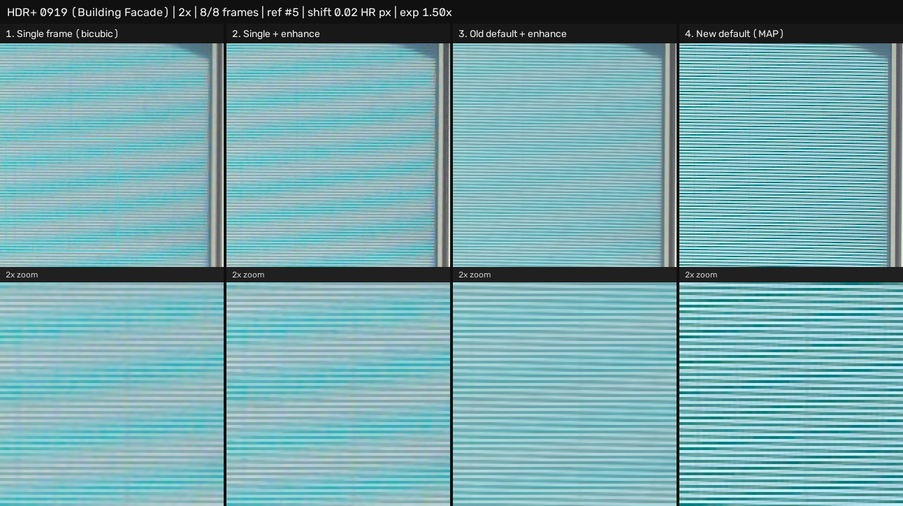
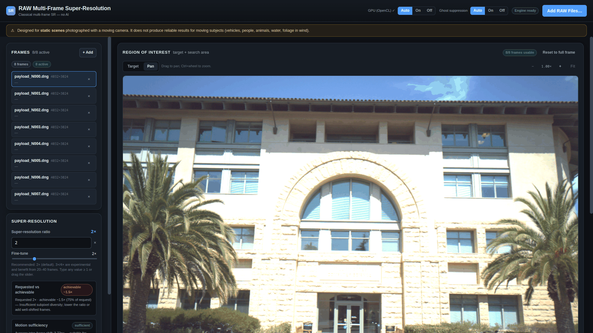
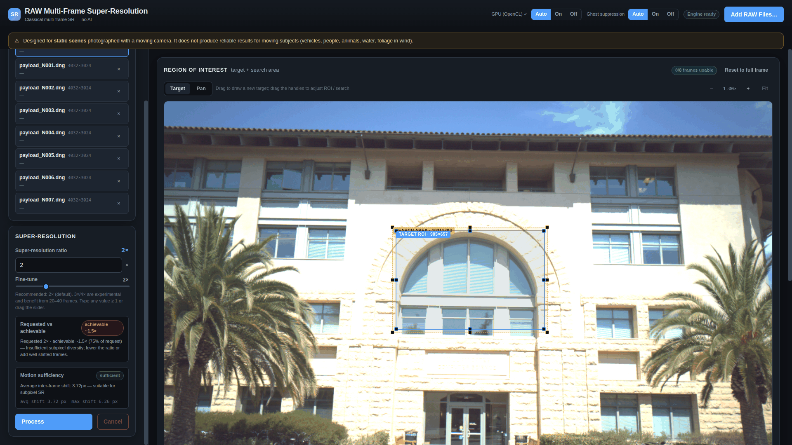
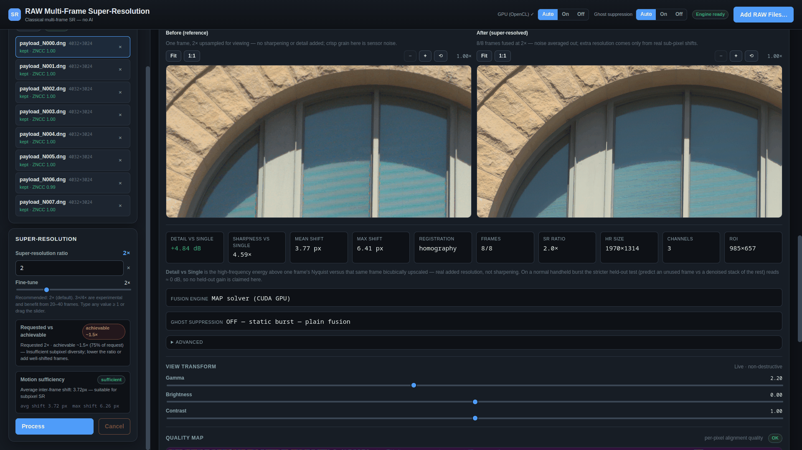
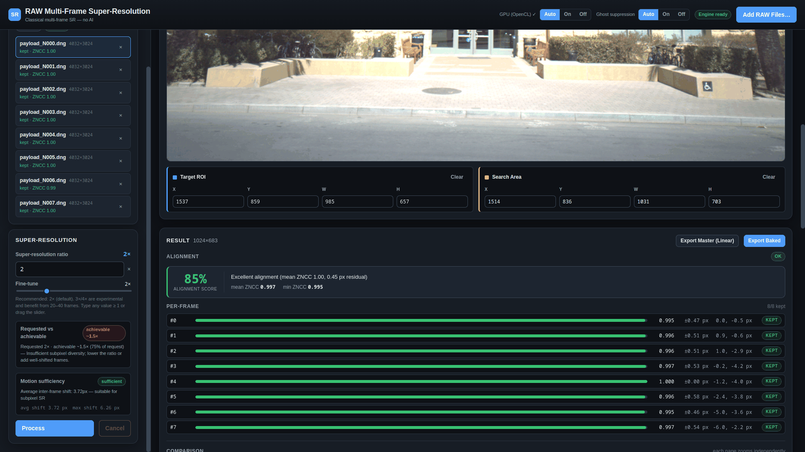
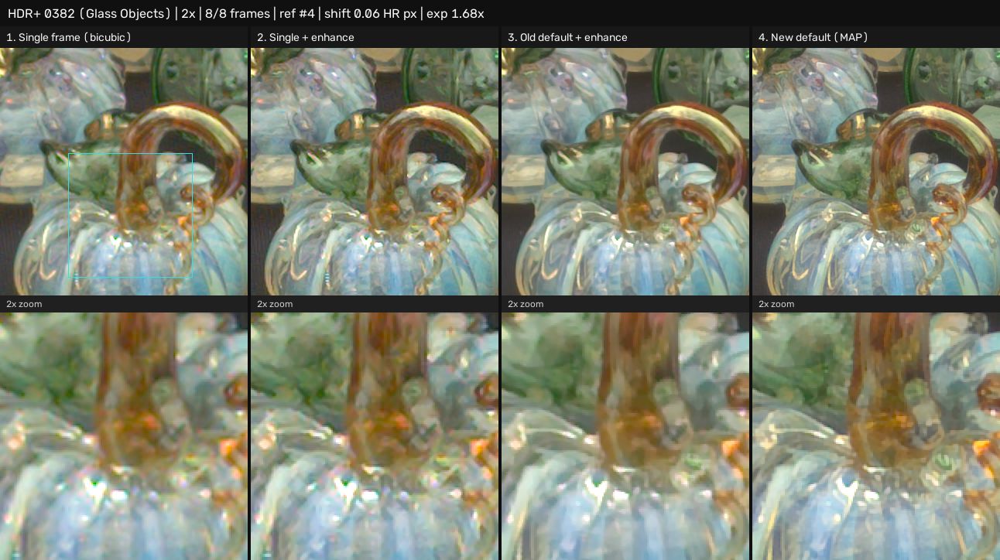
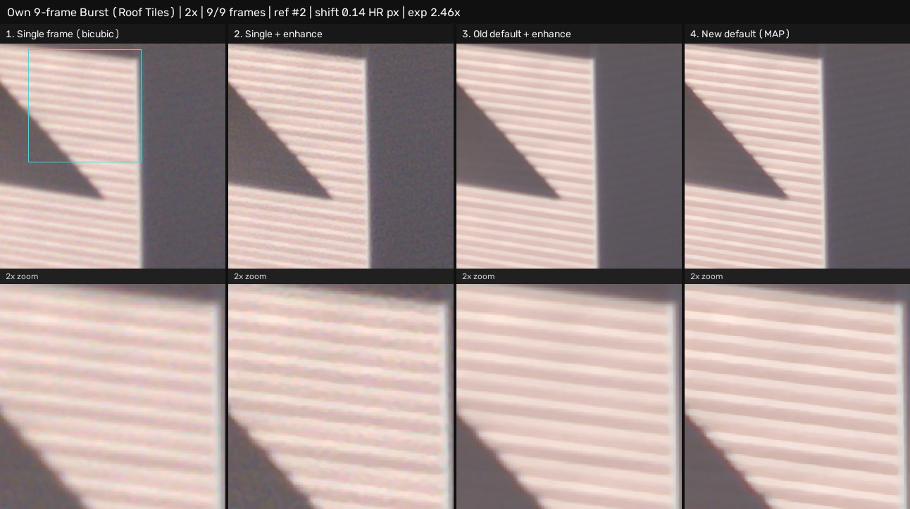
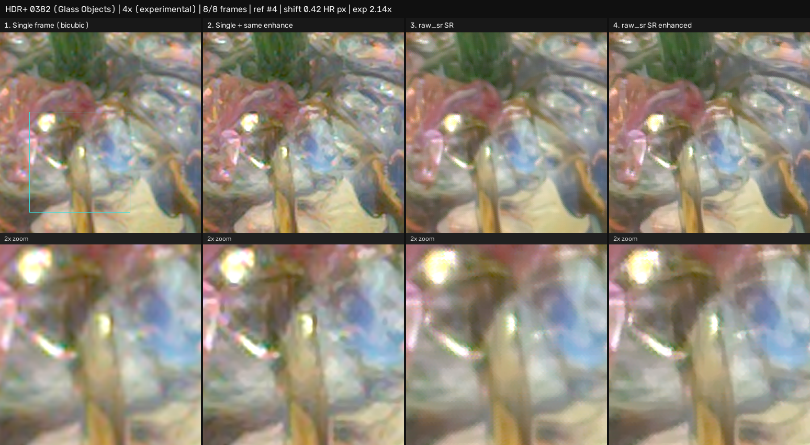

<h1 align="center">raw-sr</h1>
<p align="center"><b>Tahminden değil, gerçek ölçümden çoklu kare RAW süper çözünürlük.</b><br>
Elde çekilmiş RAW serileri için klasik sinyal işleme: alt-piksel hizalama, ileri-model MAP çözücü ve dürüst, piksel hizalı değerlendirme.</p>
<p align="center">
<a href="LICENSE"></a>


</p>
<p align="center"><a href="README.md">English</a> · <b>Türkçe</b></p>

**Klasik çoklu kare RAW süper çözünürlük — yapay sinir ağı yok.** Elde çekilmiş bir RAW serisini birleştirir; kare başına yapay netleştirme değil, kareler arası gerçek alt-piksel bilgiyle çözünürlük ve gürültü kazancı sağlar.



*`HDR+ 0919_20150910_131720_137` (bina cephesi), **2×** ölçek, 8/8 kare, referans kare `#5`. Dört panel birebir aynı HR ızgarasında (tek kare–MAP kayması tüm karede `0.02 HR px`, eski–yeni varsayılan `0.01 HR px`), aynı doğrusal pozlama ve `gamma = 2.2` ile oluşturulmuştur. Soldan sağa: **(1)** tek referans kare (bikübik), **(2)** tek kare + klasik iyileştirme (adil kıyas tabanı), **(3)** önceki varsayılan (`demosaic_drizzle`) + klasik iyileştirme, **(4)** yeni 2× varsayılanı: seriden ölçülen lens bulanıklığını da çözen ileri-model MAP SR (`fusion="auto"`, `map_mode="wp13"`, ek keskinleştirme yok; `docs/WP13_MAP_REAL.md`, `docs/WP15_MAP_DEFAULT.md`). Alt satır, en yüksek dokulu bölgenin 2× yakınlaştırılmış (nearest-neighbour) alt kırpımıdır. Panjur çizgileri (4)'te belirgin biçimde daha keskin ve kontrastlı ayrışır; önceki MAP sürümündeki düzenli piksel dokusu yoktur. **Dürüst not:** yakınlaştırmada bazı koyu çizgiler komşularından biraz daha koyu görünür (hafif vuru deseni). Kaynak veri: HDR+ Burst Photography Dataset (Hasinoff vd., 2016), CC-BY-SA; bu görsel aynı lisansla paylaşılır.*


## Bu proje neden var?

Çoğu "yapay zekâ ile büyütme" aracı, görüntüyü bir sinir ağının başka fotoğraflardan öğrendiği ayrıntıyı **tahmin ederek** keskin gösterir. Sonuç inandırıcı görünebilir, ama eklenen ayrıntı bir tahmindir: fotoğrafladığınız sahnede hiç olmayabilir.

raw-sr bunun tersini yapar. Elde çekilmiş bir RAW serisi, aynı sahnenin birbirinden biraz kaymış gerçek örneklerini içerir; raw-sr bunları alt-piksel doğrulukla hizalar ve ölçülen bu örnekleri en iyi açıklayan yüksek çözünürlüklü görüntüyü **çözer** (Bayer örnekleme, lens bulanıklığı ve gürültü açıkça modellenir). Çıktının her pikseli gerçekten kaydedilmiş veriyle sınırlanır; uydurulmuş ayrıntı yoktur. Proje iddialarını da dürüst tutar: her sonuç tek kareye ve önceki yönteme karşı piksel hizalı gösterilir, ölçümler ve çekinceler yanında yazar.

**Yapay zekâ desteği hakkında.** Bu proje yapay zekâ karşıtı değildir. Yazılımın kendisinde yapay sinir ağı ya da eğitilmiş model yoktur, çünkü amaç tahmine dayalı yeniden oluşturma değil, ölçümden gelen netliktir. *Geliştirme* ise insan yönlendirmesi ve denetimi altında, yapay zekâ kodlama asistanlarının önemli desteğiyle yapılmıştır (literatür taramaları, uygulama, testler, değerlendirme betikleri ve belgeler). Bu README'deki tüm sayılar depodaki betiklerden gelir ve yeniden üretilebilir.

## Neler yapar

- Elde çekilmiş RAW serisini (DNG, CR2, NEF, ARW ve LibRaw biçimleri) alt-piksel doğrulukla hizalar (faz korelasyonu + ECC homografi).
- 2×'te Bayer örnekleme, optik bulanıklık ve renk matrisini birlikte çözen ileri-model MAP süper çözünürlük kullanır; GPU yoksa ya da 3×/4×'te drizzle birleştirme.
- İsteğe bağlı klasik (nöral olmayan) RL-TV dekonvolüsyon + starlet dalgacık keskinleştirme.
- Kare başına uyum puanı (ZNCC), hizalama kalitesi ve hareket yeterliliği uyarıları gösterir; uyumsuz kareleri otomatik eler.
- 16-bit doğrusal ana TIFF ve görünüm eğrisi işlenmiş TIFF dışa aktarır.
- Electron + React masaüstü arayüzü, yerel FastAPI arka ucu; her şey kendi makinenizde çalışır.

## Nasıl çalışır

Elde çekilmiş bir RAW fotoğraf serisini birleştirerek **gerçek uzamsal çözünürlük artışı** ve gürültü azaltımı sağlayan masaüstü uygulaması — tek bir kareyi yapay olarak yumuşatan ya da halüsinasyon üreten bir araç değil.

Tamamen klasik bilgisayarlı görü ve sinyal işleme (OpenCV + NumPy + rawpy/LibRaw) kullanır: faz korelasyonu + ECC ile alt-piksel homografi hizalaması, 2×'te Bayer örnekleme + optik bulanıklık + renk matrisini birlikte çözen ileri-model MAP süper çözünürlük (GPU yoksa ya da 3×/4×'te drizzle birleştirme) ve isteğe bağlı klasik (nöral olmayan) RL-TV dekonvolüsyon + starlet dalgacık keskinleştirme. Yapay sinir ağı veya eğitilmiş model içermez.

## Hızlı başlangıç

Gereksinimler: Python 3.11+, Node.js 20+ ve `npm` (ayrıntılar aşağıda, “Kurulum ve çalıştırma”).

```bash
git clone https://github.com/turkerinal/raw-sr.git raw-sr
cd raw-sr
./run.sh
```

`run.sh` Python bağımlılıklarını ve arayüz paketlerini bu deponun içine kurar; hiçbir şeyi sisteme global olarak kurmaz.

**NVIDIA GPU (2× için önerilir):** 2× varsayılanı olan MAP çözücü [CuPy](https://cupy.dev) ister; doğru paket CUDA sürümünüze bağlı olduğu için otomatik kurulmaz. Projenin ortamına kurun, ör. `venv/bin/pip install "cupy-cuda13x[ctk]"` (CUDA 13) ya da `venv/bin/pip install "cupy-cuda12x[ctk]"` (CUDA 12). CuPy ya da NVIDIA GPU yoksa her şey yine çalışır, ama `fusion="auto"` MAP yerine klasik `demosaic_drizzle` yolunu kullanır.

## Masaüstü uygulaması

Aşağıdaki görüntüler uygulamanın gerçek ekran görüntüleridir (tam ekran, 1920×1080); `scripts/gui_screenshots.cjs` ile Electron penceresinden alınmıştır. Veri: HDR+ `0919` serisi (8 kare). Bu çalıştırmada 2× varsayılanı olan ileri-model MAP çözücü CUDA GPU üzerinde çalıştı (sonuç panelindeki “Fusion engine: MAP solver (CUDA GPU)” satırı).



**1. Seri yüklü.** Soldan sağa: kare listesi, süper çözünürlük oranı (varsayılan 2×), uyarılar (“achievable ~1.5×”: 8 karelik seri 2× isteğini tam karşılamaz) ve bölge (ROI) önizlemesi.



**2. Ayarlar ve ROI.** Önizleme üzerinde sürüklenerek çizilen hedef ROI (`985×657`) ve arama alanı; oran, hareket yeterliliği (“sufficient”) ve **Process** düğmesi.



**3. Sonuç.** Referans kare (2× yeniden örneklenmiş) ile süper çözünürlüklü sonucun yan yana, bağımsız yakınlaştırılabilir karşılaştırması; altında ölçümler (kare sayısı, kayma, ROI, HR boyutu).



**4. Hizalama ve dışa aktarma.** Hizalama puanı, kare başına ZNCC / artık kayma / “kept” durumu ve **Export Master (Linear)** / **Export Baked** düğmeleri.

*Ekran görüntülerindeki fotoğraf: HDR+ Burst Photography Dataset (Hasinoff vd., 2016), `0919_20150910_131720_137`, **CC-BY-SA**; bu görüntüler aynı lisansla paylaşılır.*

### İş akışı

1. **RAW Dosyalarını Seç…** — Aynı sahnenin elde çekilmiş serisini seçin (5–9 kare çalışır; en iyi sonuç için **20–40 kare** önerilir). DNG, CR2, NEF, ARW ve LibRaw destekli biçimler.
2. **SR Oranı** — **Varsayılan 2×** (önerilen). **3× ve 4× deneyseldir.**
3. **ROI (x, y, w, h)** — İşlenecek bölge (bellek koruması nedeniyle giriş en fazla `2048 × 2048` piksel).
4. **İşle** — Yükleme, hizalama ve birleştirme Python arka ucunda çalışır, iptal edilebilir.
5. **Dışa Aktar** — 16-bit doğrusal ana TIFF (`Export Master`), ekrandaki görünüm eğrisi işlenmiş 16-bit TIFF (`Export Baked`) veya klasik iyileştirilmiş çıktı (`enhanced` / `enhanced_baked`).

## Daha fazla karşılaştırma

| Sahne (2×) | Karşılaştırma |
|---|---|
| HDR+ `0382` (cam nesneler, iç mekân, CC-BY-SA) |  |
| Kendi 9 karelik DNG serisi (çatı kiremitleri) |  |

### 4× Örnek (Deneysel)



*`HDR+ 0382_20150912_130914_161`, **4× (deneysel)** ölçek. 8–9 karelik kısa serilerde 4× ızgaradaki 16 alt-piksel kutusunun yalnızca 5–7'si dolabildiği için 3× ve 4× deneysel olarak işaretlenmiştir. Kaynak veri: HDR+ Burst Photography Dataset (Hasinoff vd., 2016), CC-BY-SA.*

## Ne kadar çözünürlük kazanıyorum?

Dürüst yanıt: **odak 2× oranındadır.** Elde çekilmiş bir seriden ne kadar gerçek çözünürlük kazanılacağı fiziksel olarak **kare sayısına** ve **alt-piksel çeşitliliğine** bağlıdır:

- **8–9 karelik kısa seriler** 2× ızgaranın (4 alt-piksel kutusu) 3–4'ünü doldurabilir; ancak 4× ızgarada (16 alt-piksel kutusu) yalnızca **5–7 kutu** dolar (`docs/AUDIT_C11.md`). Bu yüzden **2× varsayılan ve önerilen orandır**; **3× ve 4× deneyseldir** ve gerçek kazanç için **20–40 karelik seriler** önerilir.
- **2×'te varsayılan MAP, optik bulanıklığı ileri modelde kendisi geri çözer;** ek keskinleştirme gerekmez ve önerilmez (sentetik GT `37,2 → 30,2 dB` düşer). Eski yolda (`demosaic_drizzle`, 3×/4× ve GPU'suz makine) görünür netlik, temiz SR ana karesinin üzerine uygulanan **klasik iyileştirmeden** gelir.

<details>
<summary><b>Ölçüm tabloları ve sentetik yer-gerçeği sonuçları</b></summary>

### Gerçek Veride Ölçülen Değerler (2×, Piksel Hizalı)

`scripts/make_showcase.py` ile ölçülen gerçek kenar MTF50 (döngü / LR piksel) ve düz alan standart sapması (`flat_std`):

| Seri (2×) | 1: Tek kare (bikübik) | 2: Tek kare + iyileştirme | 3: Eski varsayılan + iyileştirme | 4: Yeni varsayılan (MAP) |
|---|---|---|---|---|
| **HDR+ `0919`** (8/8 kare) | MTF50 `0.367` · σ `0.00356` | MTF50 `0.682` · σ `0.00426` | MTF50 `0.882` · σ `0.00157` | MTF50 `0.383` · σ `0.00181` |
| **HDR+ `0382`** (8/8 kare) | MTF50 `0.143` · σ `0.00216` | MTF50 `0.179` · σ `0.00243` | MTF50 `0.112` · σ `0.00105` | MTF50 `0.120` · σ `0.00129` |
| **Kendi 9 kare** (çatı) | MTF50 `0.051` · σ `0.00263` | MTF50 `0.142` · σ `0.00314` | MTF50 `0.126` · σ `0.00132` | MTF50 `0.052` · σ `0.00131` |

*Not: Bu otomatik kenar MTF50 ölçümü yeni MAP için görselle çelişir: `own9` ve `0919`'da (4) gözle açıkça en keskin panel olduğu hâlde düşük MTF50 alır. Ölçüm, keskinleştirme taşmasını ve örtüşmeyi (0,5'in üstündeki değerler) netlik sayar; bu yüzden burada yalnız kaba bir gösterge olarak verilmiştir. Yeni MAP'in düz alan gürültüsü eski yol + iyileştirmeyle aynı düzeydedir (`own9` `0.00131` / `0.00132`). Netlik kazancının güvenilir ölçüsü bilinen yer-gerçeğidir: sentetik sahnede eski varsayılan + iyileştirmeden lens bulanıklığı σ `0,35 / 0,60 / 0,90` LR px için **+1,0 / +1,4 / +1,9 dB**, MTF50 `0,60 → 0,83`, `0,44 → 0,75`, `0,31 → 0,58` (`docs/WP15_MAP_DEFAULT.md`).*

**Bu rakamları nasıl okumalı (dürüst yorum):** MTF50 tek başına kazancı göstermez. Tek karede ve tek kare + iyileştirmede ölçülen yüksek MTF50 değerleri (ör. `0919` için `0.682`; LR Nyquist sınırı olan `0.5` döngü/piksel üstü) gerçek ayrıntı değildir. Bunlar **örtüşmenin (aliasing)** ve gürültünün keskin kenar gibi ölçülmesinden gelir. Görseldeki asıl fark şudur: tek karede ince yatay çizgiler geniş **moire bantlarına** dönüşür; `raw_sr` SR'de aynı çizgiler düzgün ve tek tek ayrışır, düz alan gürültüsü de yaklaşık 3× düşer. `0382`'de eski yolun iyileştirilmiş SR'si düz SR'den düşük MTF50 verdi (`0.112` < `0.338`, önceki ölçüm); MAP bu sahnede ek keskinleştirme olmadan en ayrıntılı paneldir. 2×'te kazanç kare sayısıyla kendiliğinden büyümez: 20 karelik bir Pixel 4a serisinde ayrık kare (held-out) kazancı 9 kareden yüksek çıkmadı (`+0.64` / `+0.82 dB`). El kayması ve paralaks kaynaklı hizalama hatası, fazla karenin faydasını sınırlar.

### Sentetik Yer-Gerçeği (Ground-Truth) Sonuçları — *Yalnız Sentetik Hedef*

Bilinen optik PSF + Bayer mozaik + Poisson/okuma gürültüsü modelinde (ISO 12233 eğik kenar + 36 kollu Siemens yıldızı; `docs/WP1_CFA_KR.md`, `docs/WP2_ENHANCE.md`):

- **Klasik iyileştirme (`raw_sr/core/enhance.py`, WP2):** 2×'te MTF50 **+%66,8** ve sensör yer-gerçeğine göre GT PSNR **+3,61 dB** (`30,22 → 33,83 dB`); 4×'te MTF50 **+%44,8** ve GT PSNR **+3,01 dB** (`30,42 → 33,44 dB`), sıfır düz-alan gürültü artışı.
- **Doğrudan Bayer CFA çekirdek regresyonu (`fusion="cfa_kr"`, WP1 — deneysel isteğe bağlı):** Sentetik hedefte 2×'te **+3,64 dB** (IBP=1) / **+4,22 dB** (IBP=0) ve 4×'te **+4,14 dB** kazanç sağlar; ancak gerçek veride renk matrisi farkı ve hız nedeniyle henüz varsayılan değildir (`demosaic_drizzle` varsayılan kalır).
- **İleri-model MAP SR (`fusion="map"`, WP8/WP11/WP12 — ilk sürüm, şimdi `map_mode="legacy"`):** Bayer örnekleme, optik bulanıklık ve kamera renk matrisi tek bir ileri modelde çözülür. Renk-adil son kıyasta (`docs/WP12_FINAL_COMPARISON.md`) sentetik GT'de **+7..+8 dB** (`30,22 → 37,20 dB`), test kartı benzetiminde **+3,5 dB** ve Siemens yıldızı f50 `0,350 → 0,418`; renk-adil gerçek held-out ölçütünde 5 serinin 4'ünde önde (`own9` −0,27 dB). Varsayılan `fusion="auto"`: 2×'te CUDA GPU varsa ve bölge bellek sınırının altındaysa MAP, yoksa `demosaic_drizzle`. 3×/4× `demosaic_drizzle` kalır.
- **Gerçek lens bulanıklığını çözen MAP (`map_mode="wp13"`, WP13/WP15 — 2×'te varsayılan):** İlk MAP sürümü ileri modelde yalnız piksel açıklığını içeriyordu; gerçek seride lens bulanıklığı (ölçülen σ `0,4–1,1` LR px) çözülmediği için görüntü yumuşak kalıyordu. Yeni sürüm lens bulanıklığını her kanal için seriden ölçer (tek referans kare ve birleşik görüntü kestirimlerinden küçüğü; yeterli kenar yoksa `0,35`), Poisson-Gauss gürültü modeli, L-BFGS çözücü, Huber-TV, renk ve Nyquist önselleriyle çözer; kareler arası uyumsuzluk (paralaks, parlak yansıma) olan yerlerde taşmayı yerel bir sınırla bastırır. Sentetik sahnede eski varsayılan + iyileştirmeden **+1,0 / +1,4 / +1,9 dB** (lens σ `0,35 / 0,60 / 0,90`); dört yayımlanabilir gerçek seride renk kayması `< %1`, kenar taşması eski yol + iyileştirmenin en fazla `1,3×`'ü, düz alan gürültüsü daha düşük. Önceki sürüm `map_mode="legacy"` ile seçilebilir. GPU'suz makinede `fusion="auto"` yine `demosaic_drizzle` kullanır (CPU'da MAP yaklaşık 13 dakika sürer). Klasik SR yöntemleri taraması ve isteğe bağlı PnP çözücü: `docs/WP14_RESEARCH.md`, `docs/WP14_PNP_SR.md`.
- **MAP çıktısına ek keskinleştirme uygulanmaz:** MAP bulanıklığı zaten geri çözer; WP2 keskinleştirmesi üstüne binince sentetik GT `37,20 → 30,23 dB` düşer (güç 0,05'te bile `32,9 dB`). Masaüstü arka ucunun "enhanced" dışa aktarması MAP ana karesinde varsayılan olarak hiçbir şey değiştirmez; açık `enhance_strength` verilirse uygulanır.

</details>

## Sınırlar (dürüst özet)

- **Yalnız sabit sahne + hareketli kamera.** Hareketli nesneler hayaletlenir.
- **2× önerilir; 3×/4× deneyseldir.** Kısa 8–9 karelik seriler 4× ızgaranın alt-piksel örneklerini dolduramaz; yüksek oranlar için 20–40 kare önerilir.
- **Giriş ROI sınırı `2048 × 2048` pikseldir.** Tam sensör döşeme (tiling) yolu henüz yoktur; bellek bütçesi otomatik korunur.
- **`cfa_kr` (doğrudan Bayer CFA) deneyseldir.** Sentetik hedefte +3,6 dB kazanç verir; gerçek veride renk matrisi ve hız iyileştirmesi tamamlanana kadar isteğe bağlıdır (`fusion="cfa_kr"`).

## Teknik ayrıntılar

Aşağıdaki bölümler açılır/kapanır; uzun teknik ayrıntı ve ölçümler burada tutulur.

<details>
<summary><b>Klasik İyileştirme Çıktısı (Nöral Ağ Yok)</b></summary>

Doğrusal SR ana karesi (`SRResult.hr`) hiçbir zaman bozulmaz. İsteğe bağlı iyileştirme (`raw_sr/core/enhance.py`) ayrı bir son-işlem adımıdır:

1. **Yalnız parlaklık (Rec. 709 Y) işleme:** Renk gürültüsü büyümez, bellek ve süre 3× azalır.
2. **Kenardan optik PSF kestirimi + RL-TV dekonvolüsyon:** Gürültüye uyarlanan toplam varyasyon (TV) düzenlileştirmesi, Morozov uyuşmazlık durdurma ölçütü ve yerel aralık halesizleştirme (deringing).
3. **À-trous Starlet (B3 spline) çok ölçekli keskinleştirme:** 3 ölçekli dalgacık ayrıştırması, `3σ` yumuşak eşikleme ile düz alanları korur.
4. **Adil kıyas tabanı:** Aynı ayarlar tek kareye de uygulanarak (`enhance_fair_pair`) gerçek çoklu-kare avantajı şeffaf biçimde gösterilir.

> **Ne içindir?** Sabit bir sahnenin *elde çekilmiş* (hafif kamera hareketli) fotoğraf serisi. Kareler arasındaki alt-piksel kaymalar gerçek uzamsal bilgi taşır.
>
> **Ne için değildir?** Hareketli nesneler (insanlar, araçlar, hayvanlar, rüzgârda yapraklar, akarsu). Kareler arası sahne hareketi hizalama modelini bozar ve hayaletlenmeye yol açar.

</details>

<details>
<summary><b>Kurulum ve Çalıştırma</b></summary>

Gereksinimler:
- **Python 3.11+** (`rawpy` / `opencv-python` için C derleme ortamı)
- **Node.js 20+** ve `npm` (Electron arayüzü için)
- Linux'ta GUI için X11/Wayland (başsız testler için `RAW_SR_PREFLIGHT_ONLY=1` ve `pytest` kullanılabilir)

```bash
git clone https://github.com/turkerinal/raw-sr.git raw-sr
cd raw-sr
./run.sh                 # geliştirme: Vite + Electron
```

Diğer başlatma kipleri:

```bash
RAW_SR_PROD=1 ./run.sh            # üretim paketi oluştur ve başlat
RAW_SR_PREFLIGHT_ONLY=1 ./run.sh  # Python bağımlılıklarını kur, tanı yazdır, çık
RAW_SR_DEV=1 ./run.sh             # requirements-dev.txt kurulumunu da yap
```

</details>

<details>
<summary><b>Bağımsız HDR+ Veri Kümesi Değerlendirmesi</b></summary>

Projenin kendi serisinden tamamen bağımsız olarak Google'ın herkese açık **HDR+ Burst Photography Dataset** (`20171106_subset`, Hasinoff vd., 2016, **CC-BY-SA**) veri kümesinden insan içermeyen 4 seri (`0919`, `0382`, `33TJ`, `6G7M`) değerlendirilmiştir. Ayrıntılı tablo, lisans ve atıf bilgileri [`docs/HDRPLUS_EVAL.md`](docs/HDRPLUS_EVAL.md) dosyasındadır.

- **Pozlama aykırı kare koruması (düzeltildi):** HDR+ `33TJ` ve `6G7M` serilerindeki ~3,8× uzun pozlamalı son kare (`N009`) artık `max_exposure_ratio=1.5` eşiğiyle referans seçiminden önce otomatik reddedilir ve kalan karelerin pozlaması referansa normalize edilir (`docs/WP1_CFA_KR.md`).

</details>

<details>
<summary><b>Testler</b></summary>

```bash
python3 -m venv venv
venv/bin/pip install -r requirements-dev.txt
venv/bin/python -m pytest -q
```

Kapsamlı test paketi (`tests/` + `desktop/backend/tests/`) gerçek seri olmadığında ilgili testleri temiz biçimde atlar (`RAW_SR_TEST_DATA=/yol/seri` ile gerçek seri testleri etkinleştirilir).

</details>

<details>
<summary><b>Belgeler Dizini</b></summary>

| Belge | İçerik |
|---|---|
| [`docs/AUDIT_C11.md`](docs/AUDIT_C11.md) | Yayımlanan görsellerin bağımsız denetimi ve çözünürlük kaybının 5 kök nedeni |
| [`docs/IMPROVEMENT_PLAN_C11.md`](docs/IMPROVEMENT_PLAN_C11.md) | Klasik SR iyileştirme planı (WP1 + WP2) |
| [`docs/WP1_CFA_KR.md`](docs/WP1_CFA_KR.md) | Doğrudan Bayer CFA çekirdek regresyonu (`cfa_kr`) ve pozlama aykırı kare koruması |
| [`docs/WP2_ENHANCE.md`](docs/WP2_ENHANCE.md) | Klasik RL-TV + starlet çözünürlük iyileştirme (`raw_sr/core/enhance.py`) |
| [`docs/HDRPLUS_EVAL.md`](docs/HDRPLUS_EVAL.md) | Halka açık HDR+ veri kümesi (CC-BY-SA) üzerinde bağımsız değerlendirme |
| [`docs/ACCEPTANCE.md`](docs/ACCEPTANCE.md) | Kabul ölçütleri ve `PASS/FAIL/N-A` yöntemi |
| [`docs/BENCHMARK.md`](docs/BENCHMARK.md) | Performans, bellek ve doğruluk ölçümleri |
| [`docs/IBP_AND_HELDOUT.md`](docs/IBP_AND_HELDOUT.md) | IBP ve dürüst held-out metriği ayrıntıları |
| [`docs/SPEC.md`](docs/SPEC.md) | Ürün teknik şartnamesi |

</details>

<details>
<summary><b>Yol Haritası</b></summary>

- **MAP için döşeme (tiling) ve CPU hızı:** bellek sınırını (`3072² HR px × 9 kare`) kaldırmak ve GPU'suz makinede de MAP'i varsayılan yapmak.
- **20–40 karelik uzun seriler için bellek-verimli döşeme (tiling):** `2048 × 2048` ROI sınırını kaldırmak.
- **Masaüstü arayüzünde iyileştirme (WP2) önizleme ve güç kaydırıcısı:** `subtle / balanced / astro` ön ayarlarını doğrudan arayüzden kontrol etmek.

</details>

## Lisans ve veri notları

- **Kod:** GNU Genel Kamu Lisansı v3.0 ([`LICENSE`](LICENSE)). Kullanabilir, değiştirebilir ve yeniden dağıtabilirsiniz; dağıtılan türev çalışmalar kaynak koduyla birlikte GPL-3.0 altında kalmalıdır.
- HDR+ görselleri ve ekran görüntüleri: HDR+ Burst Photography Dataset (Hasinoff vd., 2016), **CC-BY-SA**; aynı lisansla paylaşılır.
- Samsung 14 serisi (Bhat vd. 2021, **CC BY-NC-SA 4.0**, ticari olmayan kullanım): yalnız ölçümlerde kullanıldı; hiçbir görseli bu depoda yoktur.
- Pixel 4a serisi yalnız dahili ölçümler içindir; hiçbir görseli yayımlanmaz.
- `bm3d` (yalnız isteğe bağlı PnP referans üst sınırı, `docs/WP14_PNP_SR.md`) ticari olmayan bir kütüphanedir; varsayılan yolun parçası değildir.
- `own9` görselleri yazarın kendi 9 karelik serisidir.
