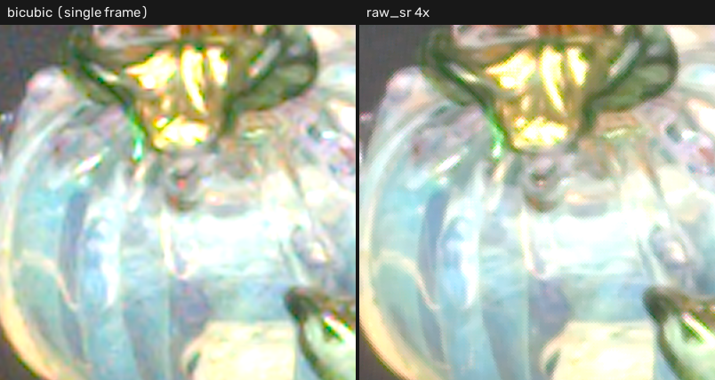

# Independent Evaluation on the Public HDR+ Burst Photography Dataset

This document records an independent evaluation of `raw_sr` (commit `6653852` on `master`, default settings) on four bursts from Google's public **HDR+ Burst Photography Dataset**, completely separate from the project's own development burst.

---

## Dataset, License, and Citation

- **Dataset:** HDR+ Burst Photography Dataset (`20171106_subset`, 153-burst curated subset)
- **Dataset page:** https://hdrplusdata.org/dataset.html
- **Public storage:** `gs://hdrplusdata/20171106_subset/bursts/<burst>/payload_N<k>.dng` (anonymously downloadable over HTTPS at `https://storage.googleapis.com/hdrplusdata/20171106_subset/bursts/<burst>/payload_N000.dng`)
- **License:** Creative Commons license (CC-BY-SA), as stated on the dataset page.
- **Usage note:** The dataset authors request scientific use and citation. Because the dataset includes photographs of the authors' friends and family, **only bursts without people** were selected for this evaluation.

```bibtex
@article{hasinoff2016burst,
  author  = {Hasinoff, Samuel W. and Sharlet, Dillon and Geiss, Ryan and Adams, Andrew and Barron, Jonathan T. and Kainz, Florian and Chen, Jiawen and Levoy, Marc},
  title   = {Burst photography for high dynamic range and low-light imaging on mobile cameras},
  journal = {ACM Transactions on Graphics (Proceedings of SIGGRAPH Asia)},
  volume  = {35},
  number  = {6},
  year    = {2016}
}
```

---

## Selected Bursts and Protocol

Four people-free bursts from Nexus/Pixel-era smartphones (10-bit RAW, white level 1023, `4032×3024` or `4208×3120`):

| Burst ID | Scene | Frames in burst | Frames evaluated |
|---|---|---|---|
| `0919_20150910_131720_137` | Building facade | 8 (`N000`–`N007`) | 8/8 |
| `0382_20150912_130914_161` | Glass objects (indoor) | 8 (`N000`–`N007`) | 8/8 |
| `33TJ_20150810_140637_256` | Brick hotel facade | 10 (`N000`–`N009`) | 9/9 (`N000`–`N008`, see Finding 1) |
| `6G7M_20150404_132758_328` | Victorian house | 10 (`N000`–`N009`) | 9/9 (`N000`–`N008`, see Finding 1) |

**Protocol:**
- Centred `1024×1024` input ROI (even-aligned to the Bayer grid, computed automatically from each DNG's visible dimensions).
- Homography registration, `--heldout-sweep`, target ratios `2×`, `3×`, and `4×`.
- Every other parameter left at default (`master` `6653852`).

---

## Full Results

| burst | ratio | frames used | achievable ratio | S2 min HF vs any single (dB) | P1 held-out min (dB) | held-out mean (dB) | SR time (s) | verdict |
|---|---|---|---|---|---|---|---|---|
| 0919_20150910_131720_137 facade (building) | 2x | 8/8 | 1.50x | -0.79 (FAIL) | +0.932 | +1.441 | 6.91 | FAIL (6 PASS, 1 FAIL, 2 N/A) |
| 0919_20150910_131720_137 facade (building) | 3x | 8/8 | 1.33x | +4.36 (PASS) | +1.526 | +1.872 | 9.72 | INCOMPLETE (7 PASS, 0 FAIL, 2 N/A) |
| 0919_20150910_131720_137 facade (building) | 4x | 8/8 | 1.25x | +9.85 (PASS) | +1.534 | +1.872 | 13.70 | INCOMPLETE (7 PASS, 0 FAIL, 2 N/A) |
| 0382_20150912_130914_161 glass objects (indoor) | 2x | 8/8 | 1.50x | +1.91 (PASS) | +0.616 | +0.785 | 6.78 | INCOMPLETE (7 PASS, 0 FAIL, 2 N/A) |
| 0382_20150912_130914_161 glass objects (indoor) | 3x | 8/8 | 2.33x | +9.68 (PASS) | +0.595 | +0.883 | 9.99 | INCOMPLETE (7 PASS, 0 FAIL, 2 N/A) |
| 0382_20150912_130914_161 glass objects (indoor) | 4x | 8/8 | 1.50x | +15.07 (PASS) | +0.572 | +0.876 | 13.63 | INCOMPLETE (7 PASS, 0 FAIL, 2 N/A) |
| 33TJ_20150810_140637_256 brick hotel (N000-N008) | 2x | 9/9 | 2.00x | +0.23 (PASS) | -0.048 | -0.030 | 8.78 | FAIL (6 PASS, 1 FAIL, 2 N/A) |
| 33TJ_20150810_140637_256 brick hotel (N000-N008) | 3x | 9/9 | 1.67x | +16.96 (PASS) | -0.059 | -0.042 | 11.97 | FAIL (6 PASS, 1 FAIL, 2 N/A) |
| 33TJ_20150810_140637_256 brick hotel (N000-N008) | 4x | 9/9 | 1.50x | +22.24 (PASS) | -0.063 | -0.047 | 15.90 | FAIL (6 PASS, 1 FAIL, 2 N/A) |
| 6G7M_20150404_132758_328 victorian house (N000-N008) | 2x | 9/9 | 2.00x | -0.28 (FAIL) | +0.212 | +0.512 | 9.89 | FAIL (6 PASS, 1 FAIL, 2 N/A) |
| 6G7M_20150404_132758_328 victorian house (N000-N008) | 3x | 9/9 | 1.67x | +11.09 (PASS) | +0.272 | +0.590 | 15.99 | INCOMPLETE (7 PASS, 0 FAIL, 2 N/A) |
| 6G7M_20150404_132758_328 victorian house (N000-N008) | 4x | 9/9 | 1.75x | +15.63 (PASS) | +0.255 | +0.609 | 14.02 | INCOMPLETE (7 PASS, 0 FAIL, 2 N/A) |

**Summary:** 8 of 12 `(burst, ratio)` runs have **0 FAIL**; 4 have **1 FAIL**.

### What `INCOMPLETE` Means

In `acceptance_verdict.py`, `INCOMPLETE (7 PASS, 0 FAIL, 2 N/A)` means **zero criteria failed**, while two criteria are structurally `N/A` on these runs:
- **`S1` (flat-field 15+ frame SNR):** Requires a 15+ frame flat-target capture.
- **`S3` (ROI-512 speed):** Defined for a `~500 px` ROI; these runs use a `1024×1024` ROI.

---

## Honest Findings

1. **Mixed-exposure robustness bug (known limitation, not yet fixed):**
   In `33TJ_20150810_140637_256` and `6G7M_20150404_132758_328`, the final frame `N009` is a ~3.8× longer exposure (mean `0.0755` vs `0.0200`), a documented quirk of the HDR+ dataset (the HDR+ pipeline itself ignores those frames). On the full 10-frame bursts, `raw_sr` selected `N009` as the reference frame and silently fused only `1/10` frames (degrading to single-frame output). Following the dataset's own protocol, those two bursts were re-run on `N000`–`N008` only (`9/9` frames fused). Reference selection should normalise exposure or reject exposure outliers; this is tracked on the roadmap.

2. **`S2` (min HF gain vs any single frame) fails at 2× on 2 of 4 bursts:**
   `0919_20150910_131720_137` (`-0.79 dB`) and `6G7M_20150404_132758_328` (`-0.28 dB`) fail `S2` at `2×`. `S2` passes at `3×` and `4×` on all four bursts (`+4.36` to `+22.24 dB`).

3. **`P1` (held-out min gain) is negative on `33TJ` at every ratio:**
   On `33TJ_20150810_140637_256`, held-out min gain is `-0.048 / -0.059 / -0.063 dB` (mean `-0.030 / -0.042 / -0.047 dB`): on that burst, `raw_sr` does not beat the equal-power denoised LR stack. On the other three bursts, held-out min gain is positive at every ratio (`+0.212` to `+1.534 dB`).

4. **Achievable ratio (`S7`) is below requested `2×`–`4×`:**
   The pipeline reports achievable ratios of `1.25×`–`2.33×` across these bursts. Short smartphone bursts (inter-frame gap `<= 33 ms`) carry limited sub-pixel diversity compared to slower handheld DSLR bursts.

---

## Visual Comparison


*`0382_20150912_130914_161` (glass objects, indoor) at 4× scale. Left: bicubic upscale of the single reference frame. Right: `raw_sr` 4× output (display-transformed). Source data: HDR+ Burst Photography Dataset (Hasinoff et al., 2016), CC-BY-SA; this image is derived from that dataset and shared under the same license.*

*The former `6G7M` 4× crop was removed: it was ~70% clipped to white (fixed exposure 4.0). Pixel-aligned, auto-exposed 2× comparisons are in the README (`docs/images/showcase_*.png`).*

---

## Reproduction

```bash
# 1. Inspect the URLs (no download)
scripts/fetch_hdrplus.sh --list

# 2. Download the 4 bursts and create N000-N008 short/ symlinks
scripts/fetch_hdrplus.sh ./data/hdrplus

# 3. Run the 12-run evaluation (optional memory/timeout wrapper via RAW_SR_WRAP)
scripts/eval_hdrplus.sh ./data/hdrplus ./output/hdrplus
```
