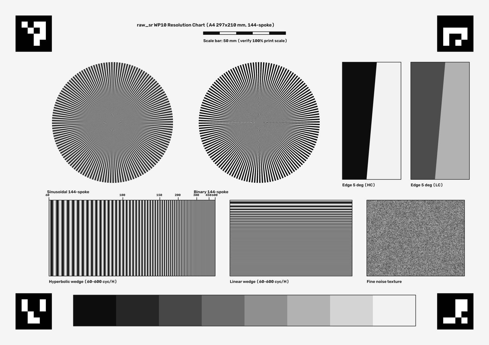
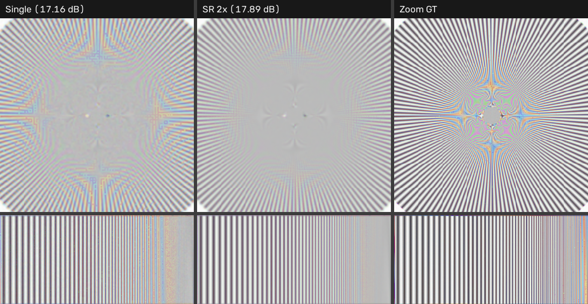

# WP10 Resolution Test Chart & Ground-Truth Shooting Guide
# WP10 Çözünürlük Test Kartı ve Gerçek-Referans Çekim Kılavuzu

This guide explains how to print the WP10 resolution test chart, photograph it in RAW (DNG) on a smartphone, and measure `raw_sr` against either a real **Zoom GT** (`d/2` or `d/3`) or **Chart-only** physical resolution metrics.

Bu kılavuz; WP10 çözünürlük test kartının nasıl yazdırılacağını, akıllı telefonla RAW (DNG) olarak nasıl çekileceğini ve `raw_sr` çıktısının gerçek **Yakınlaştırma Referansı (Zoom GT)** (`d/2` veya `d/3`) ya da **Yalnız Kart (Chart-only)** fiziksel çözünürlük ölçütleriyle nasıl değerlendirileceğini açıklar.



---

## English Guide

### 1. Generate & Print the Chart

Generate the printable A4 and A3 files (vector PDF + 600 dpi PNG):

```bash
python scripts/testchart/make_chart.py --out-dir ./charts --sizes A4 A3 --dpi 600
```

**Print settings (critical):**
- **Scaling:** `100%` / `Actual Size` / `No Scaling` (disable *Fit to Page*).
- **Paper:** Matte heavy paper (120–200 gsm). Avoid glossy or semi-gloss paper to prevent glare.
- **Resolution:** 600 dpi or higher (use the vector PDF `raw_sr_chart_a4.pdf` / `raw_sr_chart_a3.pdf` when possible).
- **Scale check:** Measure the printed scale bar with a ruler — it must be **50 mm** on A4 or **100 mm** on A3.
- Mount the chart completely flat on a rigid board or wall (no curl).

### 2. Lighting

- Use **even, diffuse daylight** (near a large window or outdoors in open shade) or two identical lamps placed at ~45° on either side.
- Avoid direct sunlight, harsh shadows, or specular glare on the paper.

### 3. Phone Camera Settings

- **Format:** RAW / DNG (Pro mode, Expert RAW, or Open Camera in DNG mode).
- **ISO:** Base ISO (typically ISO 50–100).
- **Shutter speed:** `1/500 s` or faster to eliminate motion blur.
- **OIS:** Turn Optical Image Stabilization **OFF** if the camera app allows it (natural micro-shake helps sub-pixel sampling).
- **Focus & Exposure:** Lock focus (AF-L) and exposure (AE-L) on the chart before starting the burst.
- **Zoom:** `1x` native main lens only — **no digital zoom**.

### 4. Distance & Framing

- Stand parallel to the chart so all **4 corner ArUco markers** are clearly visible inside the frame with a small margin.
- **Protocol B (chart-only):** choose distance **`d`** so the chart fills ~75–85% of the frame height — each 144-spoke Siemens star will span roughly **300–500 sensor pixels** (e.g., ~60–90 cm for A4, ~90–130 cm for A3 on a 12 MP phone).
- **Protocol A (Zoom GT):** choose **`d`** so the chart fills only **~40–45%** of the frame height (about twice the distance above). Then at `d/2` it fills ~80–90% and all 4 markers stay in frame. Use A3 if you can: the stars stay larger (~200–300 px at `d`).

### 5. Shooting Protocol

- **Protocol A — Zoom GT (recommended):**
  1. **Burst at distance `d`:** Shoot **20–40 handheld DNG frames** (natural slight hand movement provides sub-pixel diversity). Place them in `session/burst/` (e.g., `burst_001.dng`, `burst_002.dng`, ...).
  2. **Ground Truth at `d/2` (for 2× SR) or `d/3` (for 3× SR):** Move to half (or one-third) the distance, re-focus, place the phone on a **tripod or steady support**, and shoot **3–5 DNG frames** keeping all 4 corner markers in frame (this works when `d` was chosen as described for Protocol A in section 4). Place them in `session/gt/` (e.g., `gt_001.dng`, ...).
- **Protocol B — Chart-only (no GT needed):**
  - Shoot only the **20–40 handheld DNG frames** at distance `d` into `session/burst/`.

### 6. Run the Measurement

**With Zoom GT (Protocol A + B):**
```bash
python scripts/testchart/measure_chart.py --burst session/burst --gt session/gt --ratio 2 --out-dir session/results
```

**Chart-only (Protocol B):**
```bash
python scripts/testchart/measure_chart.py --burst session/burst --ratio 2 --out-dir session/results
```

Outputs in `session/results/`:
- `chart_metrics.json`: per-region PSNR/SSIM vs GT, Siemens star 50%/10% limiting frequencies (cycles/LR px, global & 8 angular sectors, aliasing-reversal flag), slanted-edge MTF50/MTF10 (aliasing flagged above 0.5 cyc/LR px on single-frame), line-pair wedge limiting frequency, and flat-patch noise.
- `chart_panel.png`: side-by-side crops (`Single | SR | Zoom GT`) of the Siemens star and line-pair wedge.

---

## Türkçe Kılavuz

### 1. Kartı Üretme ve Yazdırma

Yazdırılabilir A4 ve A3 dosyalarını (vektör PDF + 600 dpi PNG) oluşturun:

```bash
python scripts/testchart/make_chart.py --out-dir ./charts --sizes A4 A3 --dpi 600
```

**Yazdırma ayarları (kritik):**
- **Ölçekleme:** `%100` / `Gerçek Boyut` / `Ölçekleme Yok` (*Sayfaya Sığdır* seçeneğini kapatın).
- **Kağıt:** Mat kalın kağıt (120–200 gr/m²). Parlama olmaması için parlak kağıt kullanmayın.
- **Çözünürlük:** 600 dpi veya üzeri (mümkünse vektör PDF olan `raw_sr_chart_a4.pdf` / `raw_sr_chart_a3.pdf` dosyasını yazdırın).
- **Ölçek doğrulaması:** Kartın üstündeki ölçek çubuğunu cetvelle ölçün — A4'te tam **50 mm**, A3'te tam **100 mm** olmalıdır.
- Kartı düz bir pano veya duvara tamamen gergin biçimde sabitleyin.

### 2. Aydınlatma

- **Eşit, dağınık gün ışığı** (geniş pencere yanı veya açık gölge) ya da iki yandan ~45° açıyla yerleştirilmiş eş iki lamba kullanın.
- Kağıt üzerinde doğrudan güneş ışığı, sert gölge veya parlama olmamasına dikkat edin.

### 3. Telefon Kamera Ayarları

- **Biçim:** RAW / DNG (Pro mod, Expert RAW veya Open Camera DNG modu).
- **ISO:** Taban ISO (genellikle ISO 50–100).
- **Enstantane:** Hareket bulanıklığını önlemek için `1/500 sn` veya daha hızlı.
- **OIS:** Kamera uygulaması izin veriyorsa Optik Görüntü Sabitlemeyi **KAPATIN** (doğal el titremesi alt-piksel çeşitliliği sağlar).
- **Odak ve Pozlama:** Seri çekimden önce odak kilidi (AF-L) ve pozlama kilidi (AE-L) uygulayın.
- **Yakınlaştırma:** Yalnızca `1x` ana lens — **dijital yakınlaştırma kullanmayın**.

### 4. Mesafe ve Kadraj

- Kartın tam karşısında, yüzeye paralel durun; **4 köşedeki ArUco işaretçisinin** tamamı kadraj içinde ve kenarlardan hafif paylı görünmelidir.
- **Protokol B (yalnız kart):** **`d`** mesafesini kart kadraj yüksekliğinin ~%75–85'ini dolduracak şekilde seçin — böylece her 144 kollu Siemens yıldızı yaklaşık **300–500 sensör pikseli** kaplar (12 MP telefonda A4 için ~60–90 cm, A3 için ~90–130 cm).
- **Protokol A (yakınlaştırma referansı):** **`d`** mesafesini kart kadraj yüksekliğinin yalnız **~%40–45'ini** dolduracak şekilde seçin (yukarıdakinin yaklaşık iki katı mesafe). Böylece `d/2`'de kart kadrajın ~%80–90'ını doldurur ve 4 işaretçi de kadrajda kalır. Mümkünse A3 kullanın; yıldızlar `d`'de daha büyük kalır (~200–300 piksel).

### 5. Çekim Protokolü

- **Protokol A — Yakınlaştırma Referansı / Zoom GT (önerilen):**
  1. **`d` mesafesinde seri çekim:** Elde **20–40 adet DNG kare** çekin. Dosyaları `oturum/burst/` klasörüne koyun (`burst_001.dng`, `burst_002.dng`, ...).
  2. **`d/2` (2× SR için) veya `d/3` (3× SR için) mesafesinde GT:** Mesafeyi yarıya (veya üçte bire) indirin, yeniden odaklayın, telefonu **tripod veya sabit destek** üzerine koyup 4 köşe işaretçisi kadrajda kalacak şekilde **3–5 DNG kare** çekin (`d` 4. bölümdeki Protokol A kuralıyla seçildiyse işaretçiler kadrajda kalır). Dosyaları `oturum/gt/` klasörüne koyun (`gt_001.dng`, ...).
- **Protokol B — Yalnız Kart (GT gerektirmez):**
  - Yalnızca `d` mesafesindeki **20–40 elde DNG kareyi** `oturum/burst/` klasörüne çekin.

### 6. Ölçümü Çalıştırma

**Zoom GT ile (Protokol A + B):**
```bash
python scripts/testchart/measure_chart.py --burst oturum/burst --gt oturum/gt --ratio 2 --out-dir oturum/sonuc
```

**Yalnız Kart (Protokol B):**
```bash
python scripts/testchart/measure_chart.py --burst oturum/burst --ratio 2 --out-dir oturum/sonuc
```

`oturum/sonuc/` çıktıları:
- `chart_metrics.json`: Bölge bazlı PSNR/SSIM (GT'ye karşı), Siemens yıldızı %50/%10 sınır çözünürlükleri (çevrim/LR px, genel ve 8 açısal dilim, örtüşme/faz terslenmesi bayrağı), eğik kenar MTF50/MTF10 (tek karede >0.5 çevrim/LR px örtüşme uyarısı), çizgi çifti kama sınır frekansı ve düz yama gürültüsü.
- `chart_panel.png`: Siemens yıldızı ve çizgi çifti kamasının yan yana kırpımları (`Single | SR | Zoom GT`).

---

## Simulated Camera Validation / Benzetimli Kamera Doğrulaması

Before printing, the entire kit was validated end-to-end with `scripts/testchart/validate_sim.py` (perspective view, Gaussian lens PSF $\sigma = 0.45$ LR px, 1 LR px pixel aperture, Bayer BGGR mosaic, Poisson-Gaussian noise, 16-frame handheld shake, and 3-frame steady `d/2` GT):


